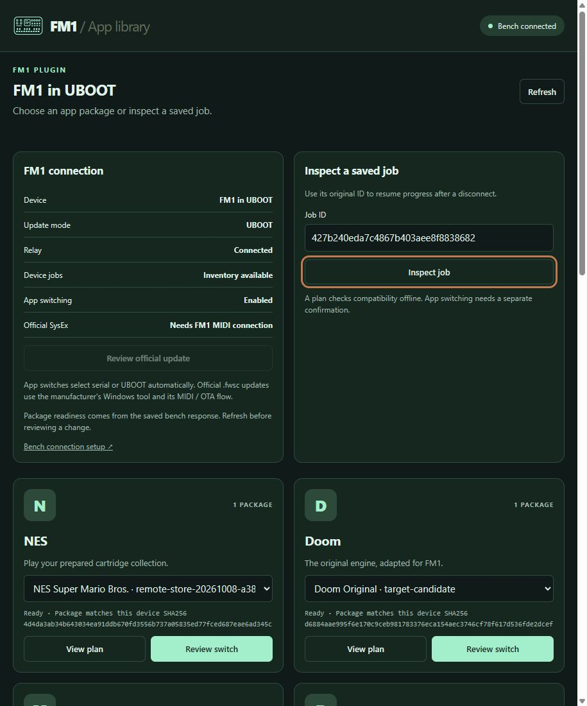

# FM-1 Forge user guide

The current native Codex serial connection test is blocked: clicking Connect
USB serial produced no chooser while Windows saw FM-1 on COM4. JavaScript and
storage are working, but device access is not established. See
[the current host evidence](DIRECT_DEVICE_ACCESS_20261013.md).

For the current **3.2.1** helper-free device flow, black default panel and
graphical firmware configuration, read
[FORGE_GUIDE.md](FORGE_GUIDE.md). The current source resource is
`ui://fm1/forge-panel-v20.html`; dated deployment checks are recorded separately.
Open the
native conversation tab through **New Tab (+) → More tools… → Plugins and MCPs
→ FM-1 Forge** to see configuration drafts, native settings, file editing and
chat context/draft actions. Read [MCP_EXTENSIONS.md](MCP_EXTENSIONS.md)
for the complete extension surfaces and platform capability checks. Older
expanded cards can retain earlier UI.

The panel includes its JavaScript runtime. You do not separately install
JavaScript, Node or Python for normal connections, stock SysEx updates or local
app-set imports. Device access uses browser permission from an explicit button;
the panel does not launch a helper, relay or Startup process.

The default is plain, opaque black with **Reset to Forge Black**; thirteen
palettes and five patterns remain available as local preferences. The module
designer opens by default, preserves CDC/UBOOT recovery and lets you select UAC,
optional 256×240 YUY2 / 5 fps UVC screen output, the LCD preset and diagnostics
or your own user module. New projects preserve `sdk-default`, measured at
360 MHz on the tested unit; CPU is a read-only summary with no tweak selector.
Older `sdk-320` drafts remain compatible and retain their stock-DMA restriction.
The UVC transport was physically confirmed in the ProTracker session; the new
Forge combination remains unflashed and needs its own capture acceptance.

The main editor is expanded. **Getting started** holds the optional 01–04 guide.
Saved-request tables and manual job-ID inspectors are removed from everyday
use. Only a current stock transfer shows progress. Its original attempt stays
in a browser IndexedDB journal; an uncertain result blocks new updates and
requires a separate recovery review. Refresh never repeats a write.

On 2026-10-12, protected local bench transfers, startup observations and three
CPU benchmark runs passed for both the preserved SDK-default clock (360 MHz
on this unit) and `sdk-320`, including USB audio duplex under the final run.
The original MOD firmware was restored and its serial startup verified. The
[clock benchmark report](https://github.com/Keitark/fm1-tracker/blob/codex/12-fm1-forge/docs/FM1_FORGE_CLOCK_BENCH_20261012.md)
records the measurements and acceptance limits.
Those CLI checks are hardware evidence for that dated unit, not a claim that
the new UVC configuration was flashed. In the direct panel, **New firmware
project** and **Ask Codex** are available without the old diagnostics-proof
gate. Ask Codex sends the reviewed configuration through a supported host
message or provides a copyable prompt. Local C compiler/build work is separate
from a connection helper; the panel does not flash custom firmware or certify
a build. Physical inputs, LCD and audible sound checks remain separate.

## Connect FM-1 directly

Click **Connect USB serial** for custom CDC firmware. Choose the FM-1 diagnostics
device and accept the host permission prompt. The panel checks VID `3654` /
PID `5155`, opens 115200 baud and recognizes the firmware's HELLO identity.
**Refresh** then sends only the known read-only status command. One DTR
assertion is required by the existing CDC firmware; no reset pulse, STOP,
UBOOT or raw command is exposed.

For stock firmware, use **Connect stock MIDI** and allow SysEx access. The
panel selects an exact unique FM-1 pair and checks its model. It refuses
unrelated devices, ambiguous duplicates and generic USB Composite Device
names whose physical USB identity the browser cannot establish.

No connection is opened at startup. After connecting, selected-device events
update presence automatically. Reconnect explicitly after unplugging; a
replacement device is never silently selected. The confirmed status text
stays steady during checks, with only a small blinking circle. There is no
Hardware activity dashboard. Browser API availability alone does not prove
that the host granted permission or that device access succeeded.

## Add local app sets

In **Apps library**, enter an optional set name and click **Add local set**,
or **Add exported bundle folder**. Select 1–8 existing exported catalog bundle
JSON files, up to 1.5 MB each and 12 MiB per set. Each bundle contains a 1 MiB
firmware image, image SHA256 and baseline SHA256. The browser checks metadata,
paths, canonical base64, image size and hash before saving the complete set
atomically in IndexedDB. Loose source files, binaries, ROMs and songs require
an exported catalog bundle first.

Choose **Show set** to filter imported metadata cards. **Refresh library**
reads browser storage and checks saved image hashes; it makes no helper call.
The firmware Blobs stay in this browser, and the cards display metadata only.
Imports remain unverified against the connected device and do not authorize
flashing. Custom transfer cards show **Manual UBOOT transfer**.

Storage belongs to this browser origin/profile. Host retention or an origin
change can affect it, so keep the original exported files. If IndexedDB is
unavailable, the panel says the set could not be saved; it never substitutes
an in-memory library and calls it durable.

## Install official V15 through browser SysEx

1. Connect normal stock MIDI and verify the FM-1 identity.
2. Expand **Stock firmware · V15 SysEx update**, then select the official V15
   `.fwsc` file. Firmware bytes remain inside the panel.
3. Click **Review stock update**. Check the package digest, current identity
   and exact MIDI input/output names.
4. Click **Install stock firmware** yourself. Keep USB connected and the
   panel open while it transfers and checks the reboot identity.

The accepted package is `FM-1_015`, 699,956 bytes, SHA256
`db1642b2b6fa5c2cccb11ffd13878068bb28601678d3644049f99dc40e7edb8a`.
The manufacturer lists it on the [download page](https://www.m-vave.com/download).
Selecting/reviewing the file does not write firmware. Transfer requires strict
IndexedDB durability and an exclusive Web Lock; without these, writing remains
disabled. Neither a Node runtime nor a Python service is involved.

An uncertain attempt retains its original IDs and blocks a new update.
**Review original transfer recovery** requires the same official file and a
fresh verified `ota-FM-1` identity; **Resume original transfer** is another
explicit confirmation. There is no automatic retry. Completion verifies
`FM-1_015` after reboot and reports that full flash readback was not performed.
A later custom flash requires a fresh verified current-unit baseline.

The currently connected custom firmware exposes CDC on COM4 and no stock
MIDI, so the physical stock/SysEx test remains pending. A separate authorized
stock restore is needed first. Read the dated
[direct-device evidence](DIRECT_DEVICE_ACCESS_20261013.md) and
[stock evidence](STOCK_SYSEX_20261013.md) for actual permission, storage and
hardware results; offline tests do not establish these outcomes.

## Appearance

The Forge interface owns its full opaque background, including headings,
card gaps and footer. Codex's surrounding chrome keeps the app theme. The
default is **Forge Black / Solid**, with **Reset to Forge Black**. Thirteen
palettes, five patterns and custom background/accent colours remain available;
foreground and panel colours are derived for contrast. Preferences are local
and saved only where the host allows storage. Appearance changes send no
device command.

## Custom flashing and legacy setup

UBOOT's vendor mass-storage protocol is outside standard Web Serial/Web MIDI.
The direct panel provides read-only serial diagnostics and official stock
SysEx transfer; custom firmware flashing remains a separate manual/legacy
bench operation with its own package/baseline review and authorization.
The old protected writer, Node MIDI worker, vendor updater and their receipts
are retained. They are not normal Forge prerequisites or automatic fallbacks.
The previous Windows helper Startup shortcut is disabled reversibly, with its
rollback copy preserved.

Legacy helper instructions and dated App Library receipts

Everything below describes the earlier helper/relay architecture. The dated
observations are preserved as history; its startup, polling, job inspector
and transfer instructions are not the 3.2.1 default flow.

## Legacy automatic device detection (3.1.4)

Run `tools/jieli-wl82/start-forge-services.ps1` from normal, non-administrator
PowerShell to restore the local inventory bridge and outbound Site relay.
`-PrepareOnly` validates existing private files, runtime and process metadata
without launching services or making HTTP requests. The wrapper reuses your
existing tokens, app library and saved jobs. It preserves verified running
services, including an attached protected bench session; a reused PID or an
unhealthy live bridge stops recovery without killing processes or duplicating
them.

The current published panel refreshes passive inventory automatically while
visible and checks again on return. Pending status requests are inspected at
one-second intervals; their relay heartbeat is refreshed independently. A
successful status cycle promptly starts the next cycle. **Bench connected**
describes the relay, while the device heading describes FM1 presence. Inventory
older than 15 seconds is marked stale. A small blinking circle indicates a check
while the last confirmed heading stays steady. Stale data does not enable
transfer actions. Saved receipts and drafts remain intact. **Refresh** also
reloads package metadata.

Freshness uses the local scan time, so time spent waiting in the request queue
does not make a newly detected connection stale. Replayed old results retain
their original timestamps. A temporary refresh error preserves a still-fresh
observation until normal expiry and displays a retry notice. UI resource v14
retains all older aliases; close and reopen an existing Forge tab once to load
it. A fresh native tab previously confirmed automatic COM4 detection without a full Codex
restart or reinstall.

Reopen the Forge panel once to load the newly published resource. A complete
Codex restart or plugin reinstall is not required for this hosted UI update.

A newly started bridge provides passive device detection without attaching an
old flashing helper. Newly started relays keep custom firmware switching,
vendor-updater handoff and native stock SysEx updating disabled. A protected
session must be established separately for custom serial/UBOOT transfers.
Stock SysEx uses its separately configured local native Node worker. The wrapper can be run
again safely and is suitable for a reversible per-user Startup shortcut; it
does not register startup entries itself. A hidden, normal-user **FM1 Forge
connection** shortcut was registered in this user's Windows Startup folder on
2026-10-12. Running the wrapper twice preserved the healthy bridge and relay;
startup after an actual Windows restart has not yet been tested. Check **Bench
connected** and fresh device status in Forge after launch.

## Legacy Node stock SysEx setup (3.1.4)

Use **Connection & updates → Stock firmware via SysEx** with one recognized
stock FM1 MIDI input/output pair. Custom CDC/UBOOT firmware needs a separate
reviewed stock restore before this route is available. Review the package
SHA256, identity and exact MIDI names, then click **Install stock firmware**
once. The review itself does not write anything.
If FM1 is already in OTA mode, new stock review stays disabled: inspect and
recover the original transfer locally. This is not a second update submission.

The local worker uses Node 22 and `@julusian/midi` 3.8.1 for the official V15
`.fwsc` package: `FM-1_015`, 699,956 bytes, SHA256
`db1642b2b6fa5c2cccb11ffd13878068bb28601678d3644049f99dc40e7edb8a`.
It checks the package and fresh model handshake, handles the stock SysEx/OTA
transfer, and checks the reboot identity. Completion does not imply full flash
readback. A successful stock update invalidates the old protected baseline and
diagnostic proof; establish a fresh verified baseline before custom writes.
An unknown outcome requires local recovery review and cannot automatically retry.

The bench owner configures a local JSON file with `nodeBinary`,
`localPackagePath` and `reviewedSha256`, supplies it as `-StockSysExConfig` to
`start-remote-bridge.ps1`, and explicitly enables `-AllowStockUpdate` on
`start-site-relay.ps1`. Preserve existing service state and receipts when
changing launch settings; launchers do not kill or duplicate a running service.
The hosted page cannot select local executable paths or transmit arbitrary
MIDI messages. Python still runs bridge/relay orchestration and the protected
custom serial/UBOOT route; the stock MIDI writer is JavaScript.

**Connection details & vendor updater** retains the separate M-UPGRADE GUI
handoff. Opening that GUI does not establish firmware transfer completion.

## Earlier App Library guide

The material below records earlier App Library behavior and dated bench checks.

Use the installed **FM1 App Library** plugin in ChatGPT or Codex and ask it to
open your FM1 app library. Its native panel is the primary interface selected
for this integration. The private [FM1 App Library website](https://fm1-app-library.keitark.chatgpt.site)
is also available; sign in with the owner account when prompted. Both use the
[black/mint FM-1 mark](../site/public/fm1-icon.png).

An earlier 2026-10-10 host check failed with a trusted-tool-scope rejection and
**Unknown tool**; [issue #6](https://github.com/Keitark/fm1-marketplace-plugin/issues/6)
records that observation. Later installed-tool and native panel openings
succeeded. That historical failure does not describe current tool availability;
the latest connection and deployment evidence is in
[VERIFICATION.md](VERIFICATION.md).

## Legacy appearance receipts (2026-10-10)

The Appearance controls were published on 2026-10-10 at 11:27 JST for resource
`ui://fm1/device-panel-v6.html`, server version **2.2.0**, with v1-v5 aliases.
The newly opened installed v6 panel showed the actual FM1 on COM10 and applied
**Mint Light / Circuit Grid**, reporting **Appearance saved on this browser**.
Open the **Appearance**
expander and choose a palette, then a **Background pattern**.

The 12 palettes are **FM1 Mint**, **Mint Light**, **Midnight Blue**, **Ocean Cyan**,
**Royal Violet**, **Sakura Pink**, **Signal Red**, **Amber**, **Forest Green**,
**Graphite**, **Paper**, and **High Contrast**. The five patterns are **Solid**,
**Circuit Grid**, **Dots**, **Scanlines**, and **Diagonal Stripes**: 60 preset
combinations in total.

For custom RGB colors, use the **Background colour** and **Accent colour**
pickers or enter six-digit hex values such as `#101a18`. Foreground and surface
colors are derived from those choices to adapt contrast. **Reset to FM1 Mint**
restores the default palette and Solid pattern.

Preferences stay local and are saved only where the host permits
`localStorage`. If storage is unavailable, the status explains that the choice
applies to this panel only. Appearance changes make no external, server or
hardware calls.

The [native Mint Light / Circuit Grid screenshot](images/fm1-native-appearance-mint-light.png)
records that installed-panel check. Native custom background `#f8f4ee` and
accent `#007ca8` with Dots also passed, and native Reset restored FM1 Mint /
Solid. The prior FM1 Mint / Circuit Grid choice was then restored in the
[final native screenshot](images/fm1-native-appearance-final.png), which shows
all 12 choices. Persistence after reopening and additional palette checks were
verified only in the synthetic preview and formal tests.

The [Mint Light / Circuit Grid preview](images/fm1-appearance-mint-light-preview.png)
and [Royal Violet / Scanlines preview](images/fm1-appearance-violet-preview.png)
show synthetic embedded-host previews, rather than an actual native bench panel.

## Historical progress and NES switch (2026-10-10)

In the v6 panel, the progress bar appeared under **Saved requests & progress** when a job was
selected. With host tools available, the updated UI follows the original job automatically through sector
verification, full readback and startup. A full sector bar alone does not mean
the entire operation has finished. Tracking pauses on connection loss, an
unknown outcome, or its polling limit; **Inspect job** resumes that exact ID
without submitting the firmware operation again.

**Refresh** updates device/catalog data when host tools are available; it does
not reload the UI resource. Published v6 preserves selected progress. During the earlier v5 check,
a freshly opened native panel received cached v4; the later v6 panel loaded
the current Appearance controls successfully. These are dated cache
observations. A directly connected custom MCP plugin has a documented
[connection-level Refresh flow](https://developers.openai.com/plugins/deploy/connect-chatgpt).
That flow differs from the panel's device-data button. Older saved request
entries are delivery snapshots; use **Inspect job** for current device progress.

The later NES switch `9067aa03ef7f4826b9f143722cb5635e` completed successfully:
**96/96 sectors**, a matching full-image readback, and verified serial startup.
The [saved switch result](evidence/fm1-nes-switch-20261010.json) records the
actual operation. The device subsequently reported normal serial mode on
**COM10**, with the protected session idle and unblocked. Screen, sound and
physical controls still require bench acceptance; vendor SysEx transfer has
not been tested.

## Initial v4 setup acceptance (2026-10-10)

The installed native **v4** panel works in Codex. **Refresh** shows **FM1 in
UBOOT**, six ready app packages, and switching **Enabled**. The official updater
is configured, with **Needs FM1 MIDI connection** because the connected device
currently exposes UBOOT rather than its official MIDI interface. Both local
switching and official-update capabilities were enabled deliberately after the
protected session was validated; neither setting confirms an individual update.

A NES review showed **auto → already_uboot** and the selected package digest.
It was canceled without submitting a switch. NES **View plan** subsequently
succeeded without device I/O. Its original request/job ID is
`427b240eda7c4867b403aee8f8838682`; native inspection and the installed tool
returned that same job with **96 planned sectors**, `blocked:false`, and
candidate SHA-256
`4d4da3ab34b643034ea91ddb670fd3556b737a05835ed77fced687eae6ad345c`.
At that point, write completion, full readback and boot verification were false,
and no candidate flash had been submitted. The later NES operation is recorded
above. The
[saved native plan response](evidence/fm1-v4-native-plan-20261010.json) records
the installed tool's result.

The local protected session now uses a frozen runtime, is idle/unblocked, and
has no running loader or pending reset after the plan. Its current baseline
came from two
matching actual 1 MiB device reads; the original evidence is preserved. The
relay retains its existing private state and credentials. See
[SITE_RELAY.md](SITE_RELAY.md) for the dated paths, digests and process evidence.
Vendor GUI transfer remains pending until the required official MIDI mode is
available and its separate review is confirmed.

## Install the ChatGPT/Codex plugin

Use **Install** or **Connect** on the offered **FM1 App Library** installation
card, then complete any sign-in prompts. If that offer is no longer visible,
ask to reopen the installation offer for the provisioned plugin. There is no
need to create another plugin or configure a local MCP server.

The plugin advertises a sidebar entry and a conversation panel. Historically, on 2026-10-09,
the installed plugin's library, status, catalog, and saved-job tools were
verified. The then-current Site v3 panel rendered in Codex with **FM1 on COM4** and
the black/mint interface. **Refresh** and exact saved-job inspection after
the relay restart also passed in that native panel. No Chrome
extension is required for this native plugin experience. The website can be
opened independently of plugin installation.

## Historical metadata bench state (2026-10-09, v3)

The following is the recorded metadata acceptance check. Use **Refresh** for
the current session, update mode and enable flags; later setup does not turn
these earlier observations into hardware acceptance.

Browse the five app cards: **NES, Doom, MDX, Buddha, and ProTracker**. At that
check, the local relay was connected with switching **Disabled**. It reported six
validated private package variants; all were blocked because that bridge had
no configured protected session or verified baseline at the time.

Inventory reported COM4 and CDC/audio interfaces. This verifies metadata
transport, not a device write or physical acceptance. A tested MDX **View plan**
request reached the bridge and failed with **Start a protected session on the
laptop first**. That is an expected prerequisite failure; no protected helper
was created and no device I/O occurred.

Inspection after the relay restart returned that same original job and
prerequisite failure. Refresh retained its job ID; it did not create another
plan or switch.

If the relay later disconnects, **Bench disconnected** and **Offline** are
expected. Saved responses can remain visible after a disconnect. With no
private package metadata, cards show **No package connected**; the cards
describe supported apps rather than installed firmware.

## When the bench is ready

The bridge, outbound relay, verified protected session and current baseline
are connected in the 2026-10-10 accepted setup above. Use **Refresh** before
reviewing a new operation; preserve the existing listener and its state.
If the session or current baseline is unavailable later, the bench owner must
restore the prerequisites through the established bench workflow. The Site
does not prepare that session. See [SITE_RELAY.md](SITE_RELAY.md) for connection
and recovery details.

1. The visible panel refreshes connection inventory automatically and checks
   again when you return. Pending requests are inspected every second, and a
   completed cycle promptly renews the status check. **Bench connected** describes
   the relay; FM1 presence is shown separately. A failed/old check is marked unavailable or
   stale, with the last known port kept only as history. Click **Refresh** to also
   load package metadata before reviewing an operation.
2. Choose a package variant on its app card. Check its **Ready/Blocked** state
   and displayed **SHA256**. A blocked package needs bench-side attention.
3. Click **View plan** to check the selected package offline. This creates a
   saved request and does not write to the device.
4. Keep the original transfer identity. The current panel's active
   **Resume progress** action follows that operation after a timeout or
   disconnect without another submission. Exact-ID inspection remains
   available through tools; the old v6 history table and manual job-ID field
   are historical UI, not current controls.

## Review an app switch

Switching must already be enabled deliberately at the bench. **Review switch**
opens a review without writing anything. Check the exact app, variant,
SHA-256, and entry method against the package you intend to use.

Click **Confirm app switch** yourself only when that review is correct and
the bench is ready. The approval expires and can be used once. **Cancel** or
Escape closes the review and clears its approval. Browser tools can open a
review; they do not expose a confirmation tool. The panel saves the original
job ID before submitting confirmation. If the confirmation reply is lost,
use **Resume progress** before reviewing another switch; do not
submit the operation again.

## Choose the update route

The **Auto** entry method chooses the protected app route from fresh passive
inventory: one recognized CDC interface uses the existing serial entry flow;
one UBOOT disk uses the already-in-UBOOT flow. An inventory error, duplicate
devices, conflicting modes or a changed mode prevents submission. The approved
catalog ID and package SHA-256 still identify the custom app to install.
Auto does not convert an app bundle into an official firmware package.

For the fixed official V15 package, use the native **Stock firmware via SysEx**
action described above. Its review binds the package digest and exact current
MIDI route; the local Node worker performs the update. The separate vendor
option reviews the pinned executable and opens M-UPGRADE for a manufacturer
workflow. The
[manufacturer download page](https://www.m-vave.com/download) lists the generic
[M-UPGRADE package](https://yms-file-store.oss-cn-hongkong.aliyuncs.com/software/pc/M-UPGRADE.zip)
and [FM-1 V15 firmware](https://yms-file-store.oss-cn-hongkong.aliyuncs.com/software/firmware/FM-1.fwsc).
The previously downloaded FM1-specific bundle embeds V14; the generic updater
can select the separately downloaded V15 package. Current downloads still need
local hash review before use.

A saved successful handoff means the GUI started. It does not establish a
firmware transfer or verification. Keep its original job ID if any reply is
lost. Handoff persistently blocks further device jobs because the old baseline
may no longer describe the FM1. After official completion, the bench owner must
establish a fresh protected session and verified current-unit baseline while
preserving the previous state and receipts. There is no remote unblock or
automatic retry. The native stock path now performs SysEx directly through the
local JavaScript worker; it is distinct from this GUI-launch receipt.

Automatic routing, native stock review/confirmation and vendor handoff have
offline contract coverage. Dated physical stock transfer, reboot and custom
candidate acceptance must be recorded separately for the connected unit.

## Read progress correctly

**Bench connected** means the relay is responding. Package readiness means the
bench reported a usable package. A delivered request can still contain a
failed or unknown device job; inspect the saved job's own status.

Sector counts describe reported verified progress. They do not establish
successful startup, screen output, sound, or working keys. An unknown device
outcome needs inspection by the bench owner before another device operation.
Physical acceptance remains a separate bench check.

Site version 6 is deployed owner-private with MCP enabled; actual native v6
Mint Light / Circuit Grid rendering is accepted in Codex. The initial v4
native panel acceptance remains historical. The server serves its current UI
through v1-v5 aliases
for installed-plugin compatibility, but an older cached resource or tool title
can still appear. See
[VERIFICATION.md](VERIFICATION.md) for the dated deployment, native panel,
metadata, and hardware acceptance evidence.

Further detail: [relay setup](SITE_RELAY.md), [browser tools and verification](WEBMCP.md),
[integration handoff](INTEGRATION_HANDOFF.md), and [verification evidence](VERIFICATION.md).

